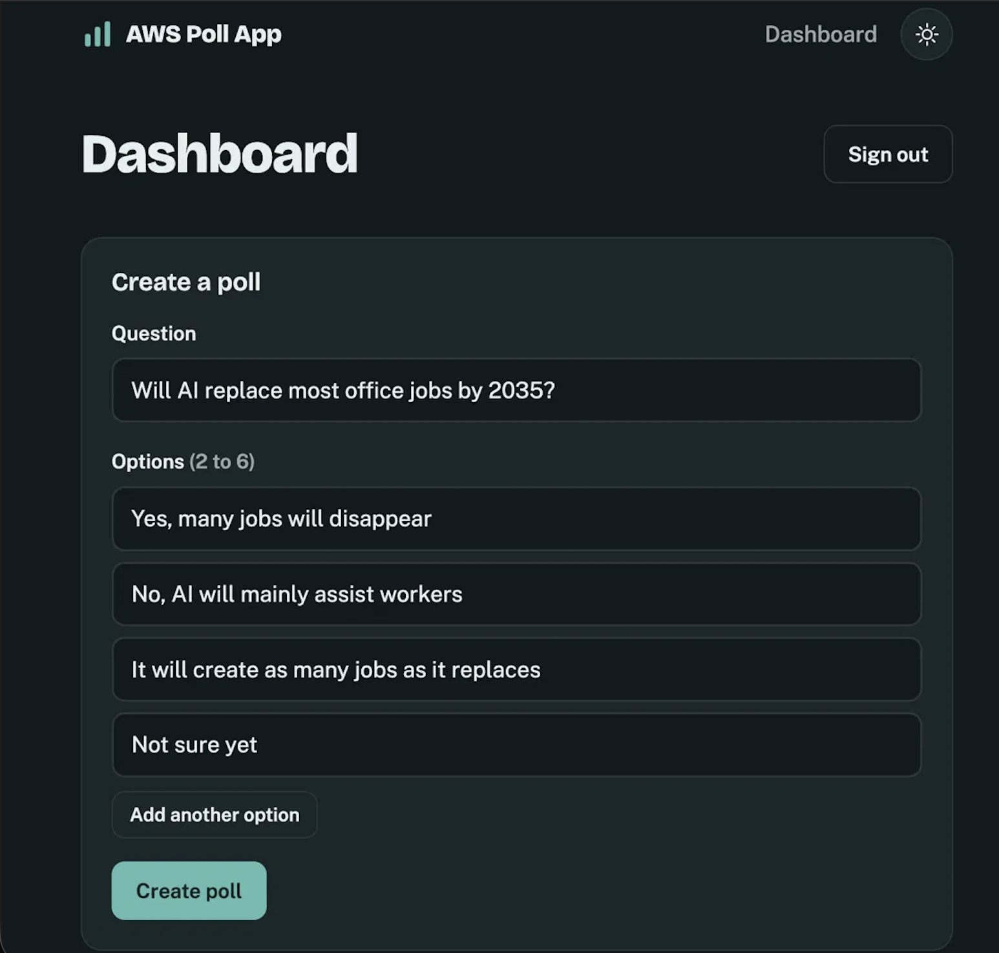
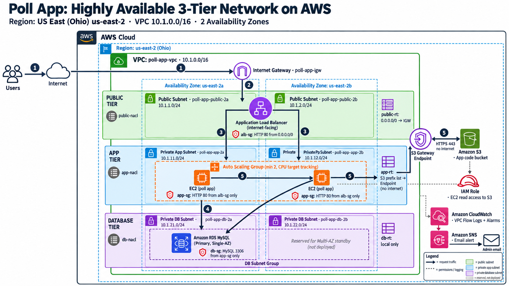

# Live Poll App on AWS: Highly Available and Auto-Scaling

A live polling app. Users vote and watch the results update in real time. It runs on a self-healing, auto-scaling AWS architecture across two Availability Zones.

## Architecture

- **CloudFront** sits in front of the **Application Load Balancer**, which runs in public subnets.
- An **Auto Scaling group** runs EC2 app servers in **private subnets** across 2 AZs (us-east-2a / us-east-2b).
- **RDS MySQL** runs in isolated private DB subnets that have no internet route.
- An **S3 gateway endpoint** lets the app servers pull code and packages without internet access.
- A **CloudWatch alarm** on `HealthyHostCount` sends email alerts through **SNS**.

| Subnet group | CIDRs | Route |
|---|---|---|
| Public (ALB) | 10.0.1.0/24, 10.0.2.0/24 | Internet Gateway |
| Private app (EC2) | 10.0.11.0/24, 10.0.12.0/24 | S3 endpoint only |
| Private DB (RDS) | 10.0.21.0/24, 10.0.22.0/24 | Local only |

## Design decisions

- **No NAT Gateway.** The servers only need S3, which the free gateway endpoint covers. This saves about $32/month and leaves a compromised server with no route to the internet.
- **Single-AZ RDS.** This is a deliberate cost trade-off for a demo. In production I'd enable Multi-AZ so the database fails over automatically.
- **Separate route table per tier.** The DB subnets can't reach S3 or the internet, even by accident.

## Resilience test

I terminated a running EC2 instance to simulate a failure:
1. The ALB shifted all traffic to the healthy instance in the other AZ, and voting kept working.
2. The CloudWatch alarm fired and SNS emailed an alert.
3. The Auto Scaling group launched a replacement automatically.
4. The new instance passed health checks, and an "OK" recovery email arrived.

**It fully recovered in about 4 minutes with no manual action.**

## What I'd add next

- Infrastructure as Code (Terraform) to rebuild the stack in one command

- Multi-AZ RDS for database failover
- HTTPS with a custom domain and ACM certificate
- SQS in front of vote writes, to absorb traffic spikes before they hit the database
